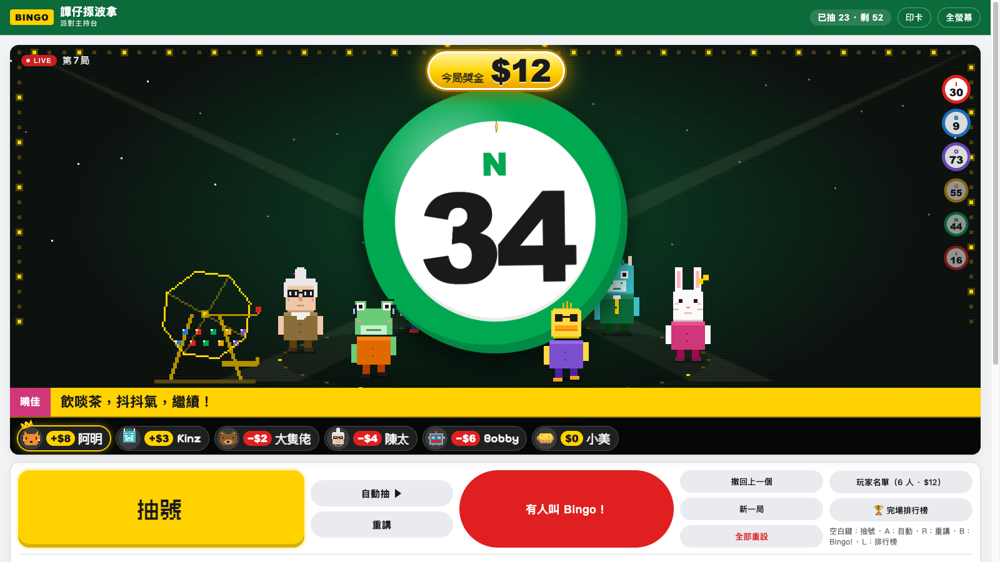
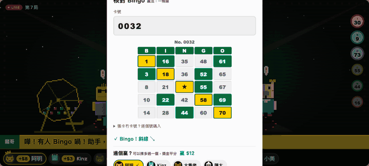
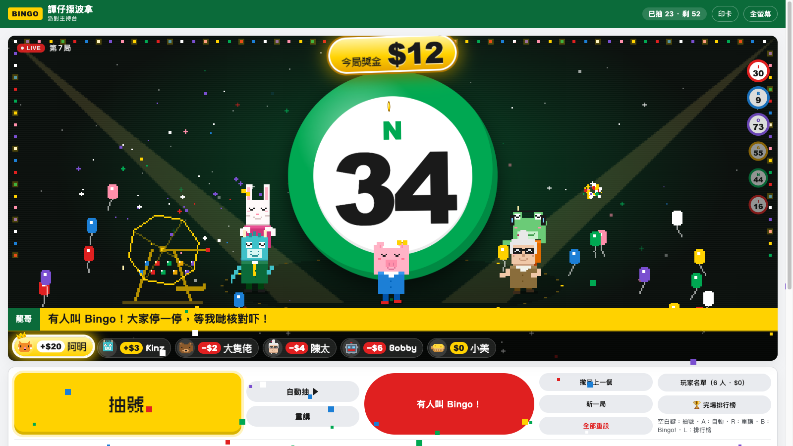
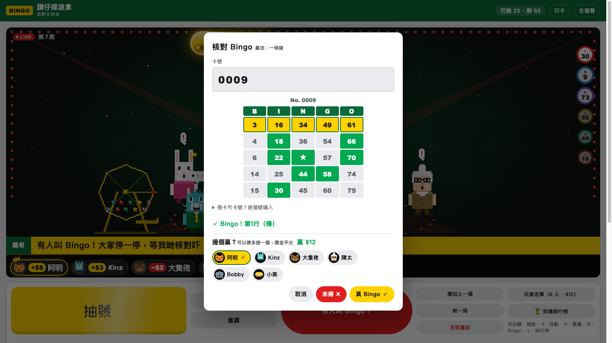
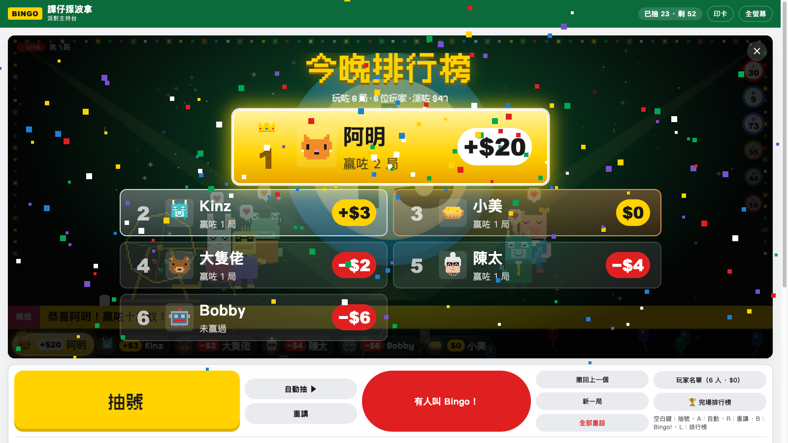
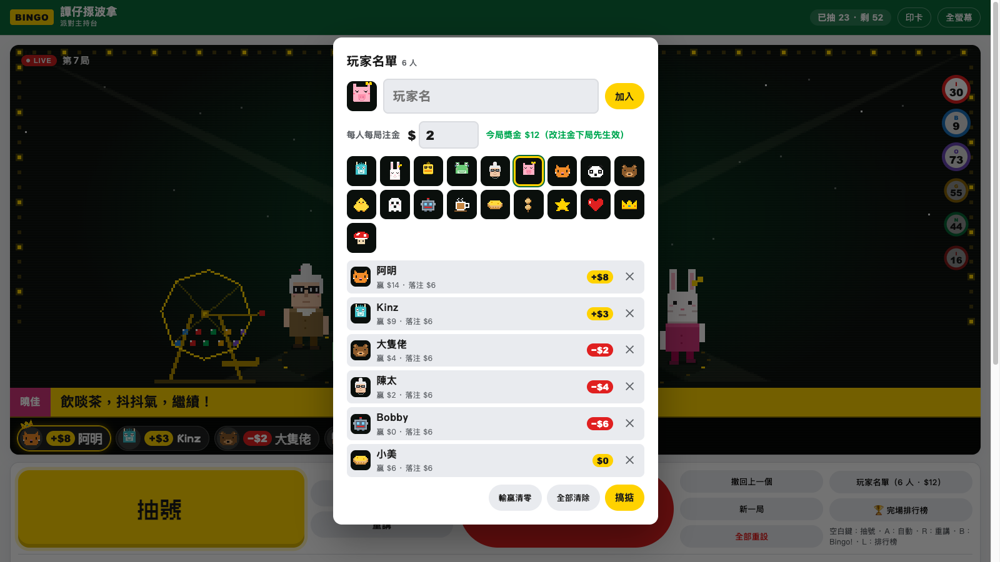
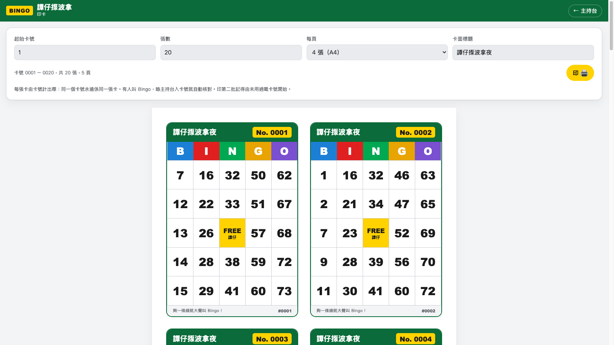
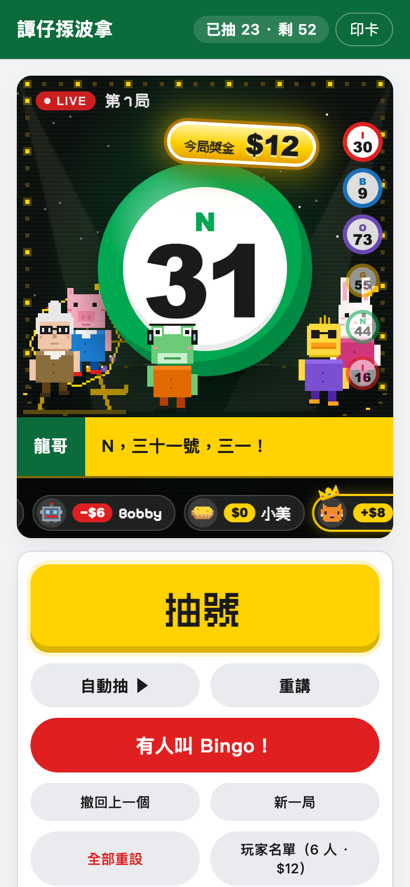

# 譚仔揼波拿 · 派對主持台

A host's console for a party bingo night, in 譚仔新聞's look. Players keep their
paper cards; this page is the cage, the caller and the board.



```sh
./run.sh            # first run creates .venv and installs edge-tts
```

The server listens on every interface (`host` in `config.json`, or `--host 127.0.0.1`
to keep it local). Open <http://localhost:8090/> — or this machine's LAN/tailnet
address from a tablet — put it on the TV, and press 開波.

| Key | |
|---|---|
| Space / Enter | 抽號 |
| A | 自動抽 on/off |
| R | 重講 last number |
| B | 有人叫 Bingo → 核對 |
| L | 完場排行榜（Esc 閂） |

**Voices.** Six callers built on Microsoft's three zh-HK voices, each with its
own rate and pitch (`CHARACTERS` in `server.py`, names in `web/calls.js`):
龍哥, 曉佳, 曉曼, 豪仔, 婆婆, 細妹. 叫號方式 picks 主持 + 助手, 輪流 or 隨機.
Clips are cached in `data/tts/`, so after the first game nothing goes to Microsoft.
No network: the browser's own Cantonese voice takes over.

**The stage.** The six callers are pixel creatures (a dragon, a rabbit, a duck,
a frog, a granny and a pig — `web/sprites.js`, after 譚仔新聞's anchors) walking
round the ball. Whoever is speaking steps forward with a microphone; the rest
react to the spin, the reveal, jokes, every tenth ball, a claim and a win
(`web/show.js`). The helper (the rabbit) works a pixel bingo cage: cranks it
during the drumroll, pulls the ball from the chute, holds it up and throws it
onto the big ball. On a real Bingo each caller does their own dance, all on
one beat (`DANCES` in `web/sprites.js`): 龍哥 disco, 曉佳 bunny hops, 曉曼 the
chicken dance, 豪仔 spins and star jumps, 婆婆 the twist, 細妹 YMCA.
Reduced-motion settings slow it right down.



**Players.** 玩家名單 on the desk (or a tap on the strip) opens the list: type a
name, pick a pixel icon (the six callers' heads, or a cat, panda, bear, chick,
ghost, robot, 奶茶, 蛋撻, 魚蛋, star, heart, crown or mushroom — `web/icons.js`),
加入. They run along the bottom of the stage, and scroll by like a ticker when
there are more than fit. The list is kept in the browser and stays across games.
Set 每人每局注金 there (e.g. $1). Every player pays it into the pot when a game
opens (開波), or on joining a game already going; the pot floats round the top
of the picture. When checking a Bingo, tick who won — any number of players;
the pot is split evenly between them (odd cents stay in), they light up on the
strip until the next game, and the helper says how much each takes. A game with
no winner ticked carries its pot over to the next. Each chip shows the player's
profit after stakes (+$12 in gold, −$3 in red); whoever is furthest up wears
the crown. The players list shows each one's winnings and stakes, and 輸贏清零
starts the books again.

**全部重設** (on the desk) starts the night over after a confirm: game 1,
nothing drawn, empty pot, everyone's money and wins back to zero; tick the box
to clear the player list too. Settings stay.

**End of the night.** 🏆 完場排行榜 (or L) puts the night's table over the
picture: everyone ranked by profit (then games won), revealed from the bottom
up, a drumroll, and the top spot with a fanfare, confetti, the callers dancing
and the host naming the big winner. Esc or ✕ closes it.

**Countdown.** While 自動抽 is on, a ring on the stage counts down to the next
ball (the 自動間隔 setting), turning red and ticking for the last three seconds.

**Sound.** All synthesised in the browser (`web/sfx.js`): a drumroll and riser
under every draw that get faster, louder and higher as more balls come out; a
heartbeat between draws from about a third of the way in, quickening as it
goes; an alarm and air horn when someone claims Bingo; a fanfare, applause and
fireworks for a real one; a sad trombone for a false one. 音效 and 緊張心跳
can be switched off in 設定.

**Jokes.** Number homophones (十八實發, 五十四唔死…), helper lines and between-call
banter all live in `web/calls.js`. 搞笑程度 controls how often they're used.

**Cards.** 印卡 (`print.html`) prints numbered 1–75 cards, 1, 2 or 4 to an A4 page.
A card is computed from its number alone (`web/cards.js`), so when someone shouts
Bingo the host types the card number and the console rebuilds the card, marks it
and says whether it wins under the 贏法 setting (一條線 / 兩條線 / 四角 / 全卡).
Cards without a number can still be checked by typing their numbers in.

The game is kept in the browser (localStorage), so a reload carries on where it left off.

## Screenshots

| | |
|---|---|
|  |  |
| A real Bingo | 核對 Bingo — type the card number, tick who won |
|  |  |
| 完場排行榜 | 玩家名單 and the books |
|  |  |
| 印卡 | On a phone |

## Licence

MIT — see [LICENSE](LICENSE). The bundled Fusion Pixel font is under the SIL
Open Font License ([web/vendor/fonts/FUSION-PIXEL-OFL.txt](web/vendor/fonts/FUSION-PIXEL-OFL.txt)).
